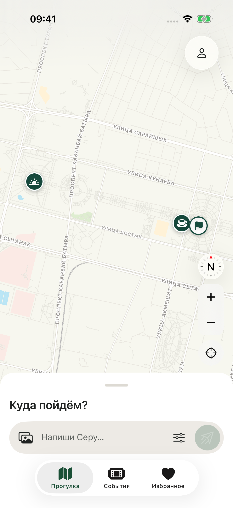
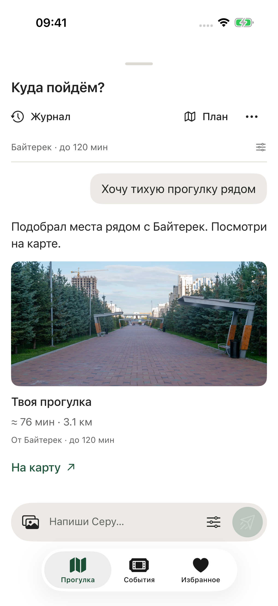
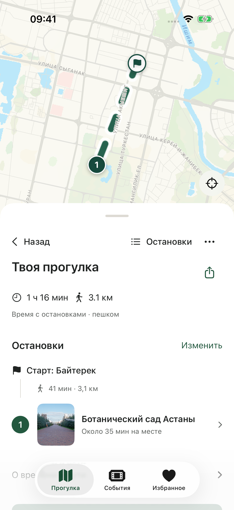
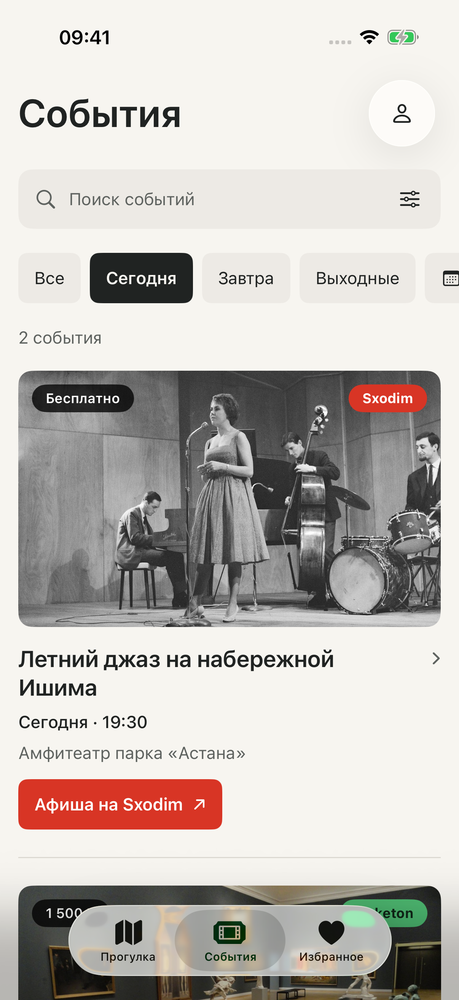
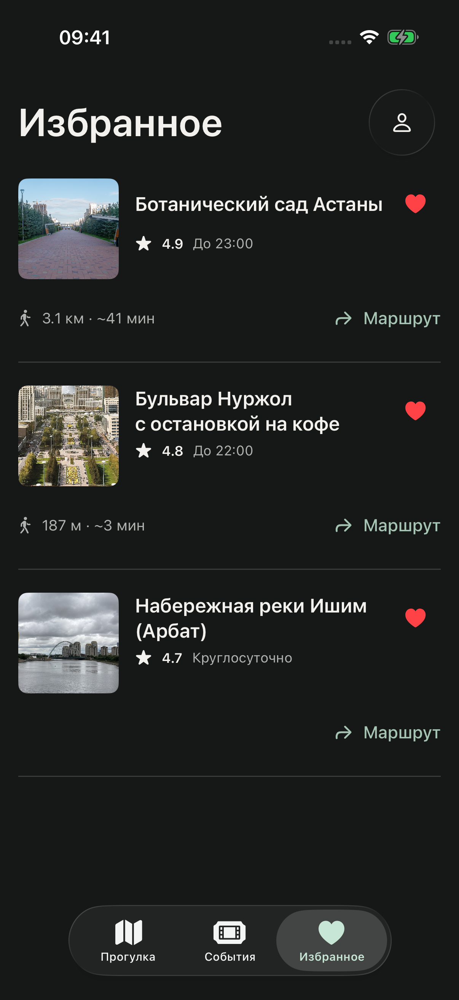
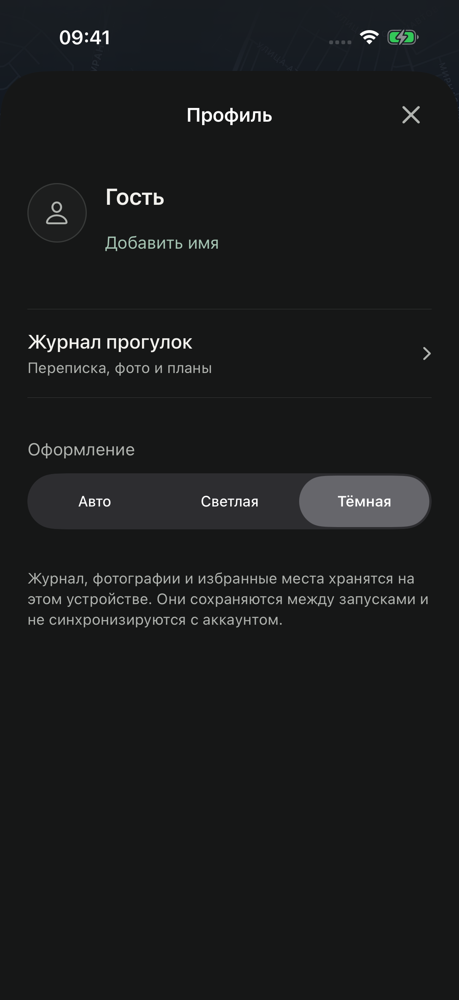

# Seruendesh · iOS

Нативный гид по Астане на SwiftUI. Выберите точку старта, время и пожелания — Серу предложит места для прогулки, покажет их на карте и поможет составить план с остановками. В приложении также есть городская афиша, избранные места и журнал прогулок.

По умолчанию приложение запускается с локальными демоданными. Для знакомства с интерфейсом сервер и ключи API не нужны.

## Скриншоты

<table>
  <tr>
    <td align="center"><br><sub>Прогулка</sub></td>
    <td align="center"><br><sub>Чат с Серу</sub></td>
    <td align="center"><br><sub>Маршрут</sub></td>
  </tr>
  <tr>
    <td align="center"><br><sub>События</sub></td>
    <td align="center"><br><sub>Избранное</sub></td>
    <td align="center"><br><sub>Профиль</sub></td>
  </tr>
</table>

Снимки из iPhone 17 Pro, iOS 26.5, режим `demo`. Показаны светлая и тёмная темы.

## Возможности

- **Прогулка:** точка старта, доступное время, фильтры «бесплатно» и «с детьми», рекомендации на карте MapKit.
- **Серу:** диалог с уточнениями и вложениями фотографий, переход от ответа к местам и плану прогулки.
- **Маршрут:** последовательность остановок, оценка времени и расстояния, отправка во внешние карты и системное меню «Поделиться».
- **События:** поиск, выбор дня или даты, фильтры по категории и стоимости, переход на сайт источника.
- **Избранное и журнал:** места на устройстве, восстановление условий и переписки прошлых прогулок; синхронизация мест после входа в аккаунт в режиме `live`.
- **Оформление:** светлая, тёмная и системная темы, анимированный маскот Серу, поддержка Dynamic Type и VoiceOver.

## Требования и запуск

- macOS и Xcode с iOS SDK 26 или новее; для `swift test` — Swift 6.2 или новее.
- iPhone или iPhone Simulator с iOS 26.0 или новее.
- XcodeGen нужен только для генерации проекта из `project.yml`. Внешних Swift-пакетов нет.

1. Откройте `SeruendeshAI.xcodeproj` в Xcode.
2. Выберите схему **SeruendeshAI** и доступный iPhone Simulator.
3. Запустите приложение через **⌘R**.

Для запуска на своём iPhone выберите Team в **Signing & Capabilities**. Рабочая конфигурация: Xcode 27.0, iOS Simulator 26.5, iPhone 17 Pro.

## Данные и подключение к серверу

| Режим | Поведение |
| --- | --- |
| `demo` — по умолчанию | Встроенные места, фотографии и примеры событий. Ответы чата и поиск по фото демонстрационные. Избранное и журнал хранятся на устройстве. |
| `live` | Рекомендации, чат, поиск по фото, события, геокодирование и маршруты запрашиваются у API. Доступны регистрация, вход, восстановление пароля и синхронизация избранных мест. Возможности зависят от сервера. |

Чтобы включить сервер, добавьте в **Edit Scheme → Run → Arguments → Arguments Passed On Launch**:

```text
-seru.dataMode live
```

По умолчанию используется `https://seruendesh.site`. Для другого HTTPS-сервера укажите переменную окружения `SERU_API_BASE_URL` либо аргумент запуска:

```text
-seru.apiBaseURL https://your-server.example
```

Аргумент `-seru.dataMode demo` явно включает локальный режим. В режиме `live` сетевые ошибки показываются в интерфейсе с возможностью повторить запрос.

### Ограничения и хранение

- Демособытия вымышлены, их обложки служат иллюстрациями. Ссылки ведут в городские афиши Sxodim и Ticketon, а не на билет конкретного демособытия.
- В текущем интерфейсе в избранное добавляются только **места**. Гостевые места переносятся в аккаунт отдельной кнопкой; журнал остаётся локальным.
- Локальная геометрия маршрута и время приблизительны. Пешеходный путь строит выбранное приложение карт. Apple Maps получает все остановки, другие карты — последнюю точку или путь до неё.
- MapKit может требовать интернет для загрузки карты даже в режиме `demo`.
- Журнал сохраняет до 20 прогулок, до 80 сообщений в каждой и до 24 МиБ фотографий. При заполнении старые фото удаляются.
- Сессия аккаунта использует cookie и Keychain; пароль не сохраняется. Последняя копия избранного доступна до проверки сессии, изменения требуют её подтверждения. Выход и истечение сессии очищают копию аккаунта.
- Восстановление пароля зависит от отправки писем на сервере. Ссылки `seruendesh://reset-password?token=…` поддерживаются; автоматическое открытие HTTPS-ссылок требует отдельной настройки Universal Links и Associated Domains.

## Сборка и тесты

Из корня репозитория:

```sh
# Модульные тесты ядра без симулятора
swift test

# При изменении project.yml
xcodegen generate

# Сборка для симулятора
xcodebuild -project SeruendeshAI.xcodeproj -scheme SeruendeshAI \
  -destination 'platform=iOS Simulator,name=iPhone 17 Pro' \
  -derivedDataPath .build/ios build CODE_SIGNING_ALLOWED=NO

# Модульные тесты в iOS Simulator
xcodebuild -project SeruendeshAI.xcodeproj -scheme SeruendeshAI \
  -destination 'platform=iOS Simulator,name=iPhone 17 Pro' \
  -derivedDataPath .build/ios test \
  -only-testing:SeruendeshAITests CODE_SIGNING_ALLOWED=NO
```

Если такого симулятора нет, замените `name` на установленный. UI-тесты находятся в `UITests/` и запускаются через **⌘U** или `xcodebuild test`; большинство сценариев используют `demo`. `LiveServerUITests` обращается к реальному серверу, а `AccountUITests` создаёт временный аккаунт и проверяет синхронизацию. Для них нужны доступный сервер и сеть. Скриншоты сохраняются во вложениях результатов тестов.

## Структура проекта

```text
SeruendeshAI/
  Core/               API, модели, состояние, аккаунт и локальное хранение
  Features/           Экраны прогулки, чата, событий, избранного и профиля
  DesignSystem/       Цвета, типографика и общие компоненты
  Assets.xcassets/    Фотографии, иконки и маскот
  SeruSplash/         Заставка и переход к основному интерфейсу
  Resources/          APNG-анимации Серу и атрибуция фотографий
Tests/                Модульные тесты
UITests/              UI-сценарии и снимки экранов
Design/Brand/         Исходные SVG иконки приложения
Scripts/              Экспорт иконки
docs/                 Скриншоты и документация
project.yml           Конфигурация XcodeGen
Package.swift         Отдельный пакет SeruCore для тестов ядра
```

## Графика и атрибуция

Источники фотографий, авторы, лицензии и изменения перечислены в [photography-sources.md](docs/photography-sources.md); атрибуция также включена в ресурсы приложения. Лицензии фотографий относятся к соответствующим изображениям.

Исходные SVG логотипа Secret Path и его тёмный вариант хранятся в [Design/Brand](Design/Brand/). Статичный маскот `SeruMascot` находится в `Assets.xcassets`, его анимации — в `Resources/SeruMotion`. Для повторного экспорта иконки приложения выполните `swift Scripts/render-app-icon.swift`.
